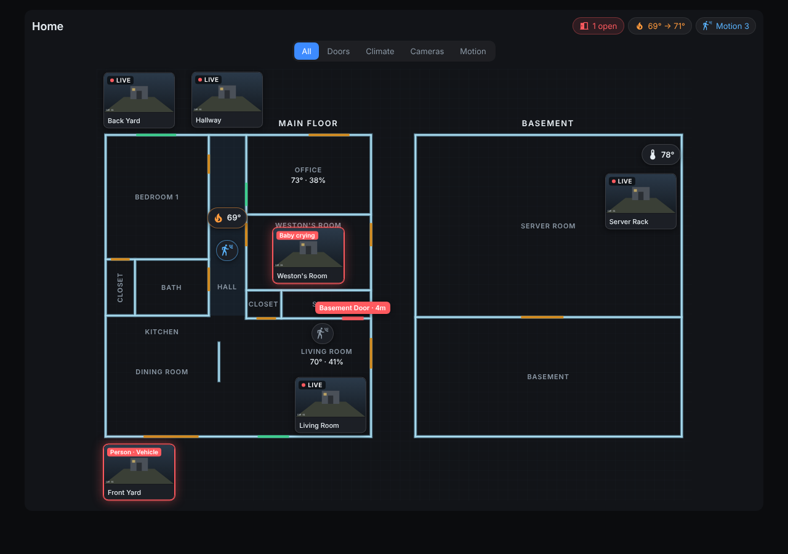

# Home View Card

A Lovelace card that draws your house as a blueprint and puts your devices on it.

- Door and window sensors light up on the wall itself: green when closed, red and blinking when open, with a tag showing how long they've been open.
- Tap the thermostat, a camera, a lock or a sensor to open its normal Home Assistant dialog. Tap a light to toggle it. Long-press anything for its dialog.
- Rooms glow when their lights are on and tint blue when their motion sensor fires.
- A status row up top (open doors, locks, thermostat, lights on, motion) and filter tabs (Doors, Climate, Cameras, Lights, Motion, Sensors).
- Camera markers can show a live snapshot that refreshes every 10 seconds.
- No build step, no dependencies. One JS file.



## Install

### HACS

1. HACS → three dots → Custom repositories → add this repo as type **Dashboard**.
2. Install **Home View Card**, then reload the browser.

### Manual

1. Copy `home-view-card.js` to `/config/www/home-view-card.js`.
2. Settings → Dashboards → three dots → Resources → Add resource:
   - URL: `/local/home-view-card.js`
   - Type: JavaScript module
3. Reload the browser.

## Setup

Add a card in YAML mode and paste [`examples/house.yaml`](examples/house.yaml). Then change the entity IDs to yours. Any entity that doesn't exist shows as a dashed marker so it's easy to spot.

The plan works best in a **Panel** view or as a full-width card in a **Sections** view.

## Coordinates

Everything is drawn in one coordinate space that you pick. The example uses the pixel positions from a floor-plan screenshot, so you can open your own image in any editor, hover over a corner, and read off the numbers.

- `walls` / `half_walls`: `[x1, y1, x2, y2]` line segments. Half walls (counters, knee walls) are drawn lighter.
- `rooms`: either `rect: [x1, y1, x2, y2]` or `points: [[x, y], ...]` for L-shaped rooms.
- `openings`: `line: [x1, y1, x2, y2]` drawn on top of a wall. Give it an `entity` to make it live.
- `devices`: an `entity` and an `x`/`y` position.

## Options

### Card

| Option | Default | Description |
| --- | --- | --- |
| `title` | | Card heading |
| `view_box` | auto | `[x, y, width, height]` of the area to show. Auto-fits the walls if left out. |
| `rotate` | `0` | `0`, `90`, `180`, `270`, or `auto` (turns sideways when the screen is landscape, nice for wall tablets) |
| `show_names` | `false` | Show the entity name under every marker |
| `chips` | `true` | Status row at the top |
| `layers` | `true` | Filter tabs |
| `grid` | `true` | Blueprint grid behind the plan |
| `camera_refresh` | `10` | Seconds between camera preview refreshes |
| `labels` | | Free text on the plan, e.g. floor names: `[{text: Basement, x: 1163, y: 18}]` |
| `stack` | | Put a second floor under the first on narrow screens. `split_x`: everything right of this x is the second floor. `move: [dx, dy]`: how far to shift it. `below`: card width in px where stacking kicks in (default `700`). |

### Room

| Option | Description |
| --- | --- |
| `name` | Label |
| `rect` / `points` | Shape |
| `label_at` | `[x, y]` for the label, defaults to the center |
| `vertical` | Write the label top to bottom, for narrow rooms like closets |
| `lights` | Light entity or list; room glows when any are on |
| `motion` | Motion sensor or list; room tints when active |
| `temperature` / `humidity` | Sensors shown under the name |
| `entity` / `tap_action` | Make the room itself tappable |

### Opening

| Option | Description |
| --- | --- |
| `name` | Used in tooltips and the open tag |
| `type` | `door` or `window` |
| `line` | `[x1, y1, x2, y2]` |
| `entity` | `binary_sensor` or `cover`. Without one the opening is drawn in neutral orange. |
| `show_tag` | Set `false` to hide the "Open · 4m" tag |
| `tag_offset` | How far into the room the tag sits (default `26`) |

### Device

| Option | Description |
| --- | --- |
| `entity` | Required |
| `x`, `y` | Position |
| `name` | Overrides the friendly name |
| `icon` | Any `mdi:` icon to override the default |
| `layer` | Force a filter tab: `doors`, `climate`, `cameras`, `lights`, `motion`, `sensors` |
| `preview` | Cameras only: show a live snapshot instead of an icon. Size scales with the card; override with `--hv-preview-width`. |
| `motion` | Cameras only: a motion sensor. The preview gets a red outline and a label while it's on. |
| `detections` | Cameras only: list of detection sensors (person, vehicle, animal, package, baby cry, ...). Shown as a label like "Person · Vehicle" on the preview. |
| `show_name` | Name under this marker |
| `show_value` | Set `false` to hide the temperature/value text |
| `show_brightness` | Lights only: show brightness % when on |
| `tap_action` | `more-info`, `toggle`, `none`, or `{action: navigate, navigation_path: /lovelace/cameras}` or `{action: perform-action, perform_action: script.goodnight}` |

Marker style follows the entity type:

| Domain | Marker |
| --- | --- |
| `climate` | Current temperature, orange while heating, blue while cooling |
| `camera` | Camera icon or live preview |
| `light`, `switch`, `fan`, `input_boolean` | Toggles on tap, glows when on |
| `lock` | Green when locked, red when not |
| `binary_sensor` door/window/garage | Green closed, red open |
| `binary_sensor` motion/occupancy | Pulses when triggered |
| `binary_sensor` moisture/smoke/gas | Turns solid red on alert |
| `sensor` | Shows the value |

## Theming

The card uses its own blueprint palette. Override any of these with card-mod or your theme:

```
--hv-bg  --hv-wall  --hv-wall-edge  --hv-half  --hv-opening
--hv-closed  --hv-open  --hv-text  --hv-muted  --hv-accent
--hv-warm  --hv-heat  --hv-cool  --hv-max-height  --hv-preview-width
```

## Demo

`demo/index.html` runs the card against fake states, with doors and motion flipping every few seconds.

```bash
python3 -m http.server 8000
```

Then open http://localhost:8000/demo/.
